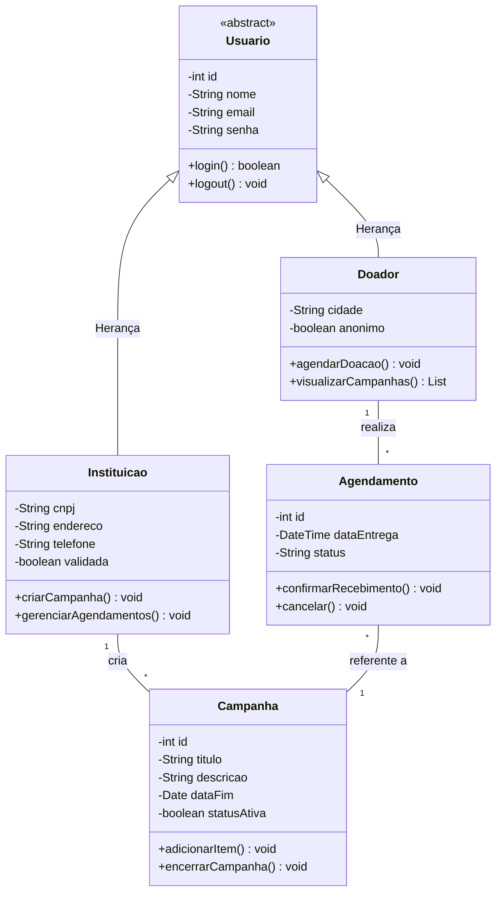

# Diagrama de Classes - DoaPerto Social

**O que mudou na prática?**
Trocamos os `-->` e `<--` por `--`. Isso cria uma linha reta padrão no Mermaid. Além disso, invertemos a ordem do último relacionamento para `Agendamento "*" -- "1" Campanha : referente a`, o que facilita a leitura de cima para baixo no desenho final: *"Um Doador realiza Agendamentos, e esses Agendamentos são referentes a uma Campanha"*.
